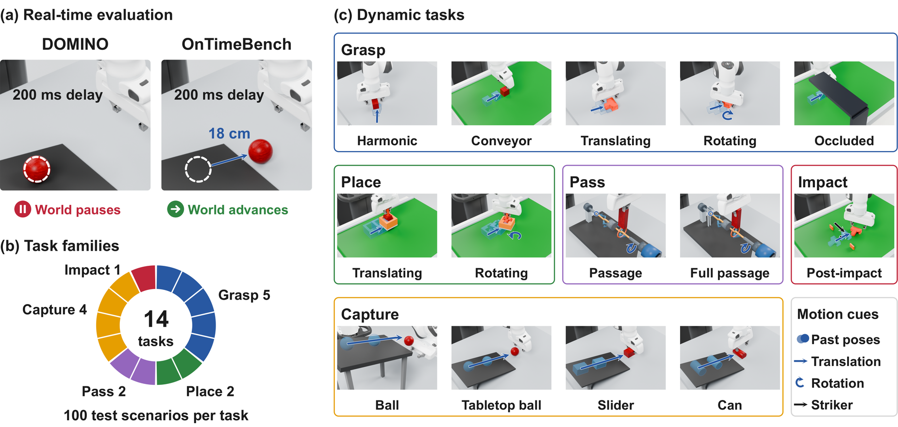
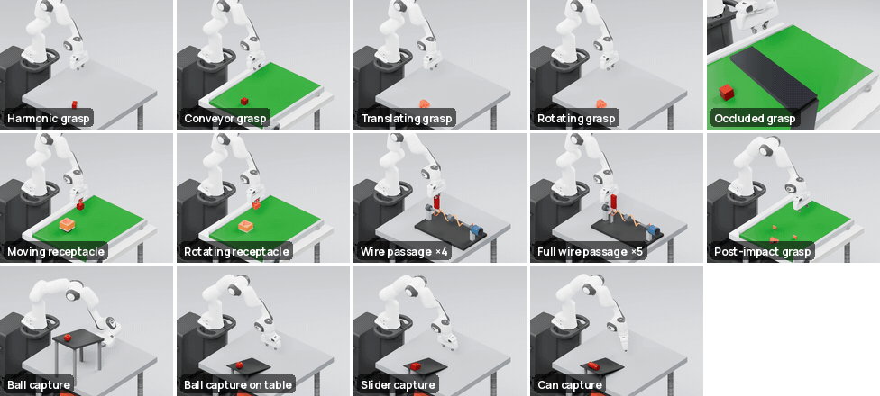

<div align="center">

## OnTimeBench: Dynamic Manipulation at Native Policy Latency

</div>

<p align="center">The benchmark released with <a href="https://github.com/ArrebolBlack/FoveaWAM"><i>FoveaWAM: Role-Aware 4D World–Action Modeling for Dynamic Manipulation</i></a></p>

<p align="center">
  Jiaqi Yin<sup>1,2</sup>&nbsp;&nbsp;
  Baoyue Zhang<sup>2</sup>&nbsp;&nbsp;
  Jiyuan Zhang<sup>3</sup>&nbsp;&nbsp;
  Wenxuan Liu<sup>2</sup>&nbsp;&nbsp;
  Zhaofei Yu<sup>2</sup>&nbsp;&nbsp;
  Yue Deng<sup>1,†</sup>&nbsp;&nbsp;
  Tiejun Huang<sup>2,†</sup>
  <br>
  <sup>1</sup>Beijing Zhongguancun Academy&nbsp;&nbsp;
  <sup>2</sup>Peking University&nbsp;&nbsp;
  <sup>3</sup>Beijing Academy of Artificial Intelligence
  <br>
  <sup>†</sup>Corresponding authors
</p>

<p align="center">
  <a href="https://foveawam.github.io"></a>
  <a href="https://arxiv.org/abs/XXXX.XXXXX"></a>
  <a href="https://huggingface.co/datasets/JiaqiYin/OnTimeBench"></a>
</p>

## Overview

OnTimeBench evaluates robot policies on 14 dynamic manipulation tasks in MuJoCo. In the default protocol, the world keeps moving while a policy computes: the evaluator advances a 20 Hz control clock by the policy's measured query time and skips commands whose ticks have already passed. A slow policy acts on a scene that has moved on, as it would on a real robot.

The release contains 1,400 held-out test scenes (100 per task), 11,200 expert demonstrations for training, and the scripted expert that recorded them.



*Left: the ball rolls 18 cm during a 200 ms query. Right: the five task families, from intercepting a block on a conveyor to grasping a puck after an impact.*

## News

- **[2026/11]** We release OnTimeBench with 14 tasks, 1,400 test scenes and 11,200 training demonstrations.

## Installation

OnTimeBench needs Python 3.11 or 3.12. On a headless Linux server with an NVIDIA GPU, also run `export MUJOCO_GL=egl`.

```bash
conda create -n ontimebench python=3.11 -y
conda activate ontimebench

git clone https://github.com/ArrebolBlack/OnTimeBench.git
cd OnTimeBench
pip install -e .
```

## Run a First Scene

Generate one training scene and record the built-in expert on it. This needs no downloaded data or weights.

```bash
ontimebench-generate-scenarios --task-id harmonic_grasp --seed 42 --num-seeds 1 --output harmonic_grasp.jsonl
ontimebench-record --manifest harmonic_grasp.jsonl --policy native-oracle --training --output demos
```

The expert intercepts a moving block. The recorder writes the episode under `demos/episodes/` and adds its entry to `demos/train.jsonl`.

## Evaluate a Policy

The test suite gives the policy a calibrated RGB-D view and the robot state. A policy is any class with the four members below; this one holds still:

```python
# my_policy.py
import numpy as np
from ontimebench.api import ActionSpec, BenchmarkAction

class Policy:
    action_spec = ActionSpec("E7", "delta", (0.05, 0.05, 0.05, 0.5, 0.5, 0.5))

    def reset(self, task_id):        # start of each scene, e.g. "harmonic_grasp"
        pass

    def observe(self, obs):          # every tick between queries
        pass

    def query_actions(self, obs):    # when a new chunk is due
        # Each row: Δxyz (m), Δrotation vector (rad), gripper in {-1, 0, 1}.
        chunk = np.zeros((8, 7))
        chunk.setflags(write=False)
        return tuple(BenchmarkAction("E7", "delta", row) for row in chunk)
```

The first action of a chunk is for the tick of `obs`. A chunk has to extend past the query delay, otherwise none of its commands reach the robot. The protocol is defined in [`evaluation/policy.py`](src/ontimebench/evaluation/policy.py), and the [FoveaWAM adapter](https://github.com/ArrebolBlack/FoveaWAM/blob/main/src/foveawam/evaluation/ontimebench.py) is a full example.

Save your measured batch-one query times, in seconds, to `latency.json`, for example `{"latency_samples_s": [0.071, 0.075, 0.073]}`. Then run the first held-out scene:

```bash
PYTHONPATH=. ontimebench-evaluate --policy my_policy:Policy --protocol native \
  --latency-profile latency.json --target-pose-source none \
  --shard-index 0 --shard-count 1400 --output first-scene.json
```

| Protocol | What happens while the policy computes |
| --- | --- |
| `native` | The world advances during inference. The robot keeps executing the previous chunk while it waits. |
| `plus150ms` | Same as `native`, with 150 ms added to every query. |
| `paused` | The world waits for inference, and the policy replans every control tick. |

For example, a query that takes 75 ms returns at tick 2 of the 50 ms clock, so the first two commands of its chunk have expired.

By default, an observation holds only the camera view and the robot state. With `--target-pose-source simulator`, it also carries `target_position` and `target_quaternion_xyzw`, the target pose in the robot base frame read from the simulator at the same tick. The report records which source was used, and the [results](#results) list the methods that read the pose.

<details>
<summary>Run the full suite or split it across workers</summary>

Drop both shard flags to evaluate all 1,400 scenes. For a distributed run, give each worker the same `--shard-count N` and a distinct `--shard-index` from 0 to N−1, then combine the reports:

```bash
ontimebench-merge --output full.json shard-0.json shard-1.json
```

If your factory can load several checkpoints, pass a JSON file that identifies the checkpoint with `--policy-settings` on every worker. The merge command checks that these settings agree across shards.

</details>

## Tasks

<p align="center">
  
</p>

*The two wire-passage clips are sped up 4× and 5×.*

Each task has 100 held-out test scenes, and the benchmark score is the mean of the 14 task success rates. Task definitions are in [`configs/tasks`](configs/tasks).

| Family | Task | ID |
| --- | --- | --- |
| Grasp | Harmonic grasp | `harmonic_grasp` |
| Grasp | Conveyor grasp | `conveyor_grasp` |
| Grasp | Translating grasp | `translating_grasp` |
| Grasp | Rotating grasp | `rotating_grasp` |
| Grasp | Occluded grasp | `occluded_grasp` |
| Place | Moving receptacle | `moving_receptacle` |
| Place | Rotating receptacle | `rotating_receptacle` |
| Pass | Wire passage | `wire_passage` |
| Pass | Full wire passage | `full_wire_passage` |
| Capture | Ball capture | `ball_capture` |
| Capture | Ball capture on table | `ball_capture_on_table` |
| Capture | Slider capture | `slider_capture` |
| Capture | Can capture | `can_capture` |
| Impact | Post-impact grasp | `post_impact_grasp` |

## Results

Mean success rate (%) over the 14 tasks, from the paper. p95 is the batch-one query time on one RTX 5090, which the evaluator replays. All policies see the main camera; the *History* column lists what each one receives from earlier ticks in addition to robot state.

| Method | History | Native | +150 ms | Paused | p95 (ms) |
| --- | --- | ---: | ---: | ---: | ---: |
| ACT | – | 41.6 | 24.6 | 40.6 | **5.8** |
| Diffusion Policy | RGB | 31.9 | 16.1 | 32.0 | 68.9 |
| π<sub>0.5</sub> | – | 54.4 | 28.1 | 66.6 | 59.6 |
| π<sub>0.5</sub> + target pose | target pose | 58.7 | 28.0 | 76.0 | 61.2 |
| DynamicVLA | RGB | 51.1 | 23.5 | 54.9 | 97.3 |
| PUMA | flow | 61.4 | 31.1 | 53.1 | 60.6 |
| OpenWAM-α | – | 46.1 | 24.8 | 58.7 | 151.7 |
| OpenWAM-α, no cache or compilation | – | 15.8 | 10.4 | 58.4 | 466.3 |
| DynamicWAM | flow | 41.1 | 20.6 | 49.6 | 149.6 |
| DynamicWAM + target pose | flow, target pose | 41.7 | 24.9 | 64.0 | 153.3 |
| FoveaWAM | target pose | **82.1** | **34.1** | **90.3** | 15.1 |

To add a method to this table, open an issue with the merged report from `ontimebench-merge` and the latency profile you used.

## Training Data

The public dataset contains 11,200 successful expert demonstrations, 800 per task. Each entry in `train_n800.jsonl` points to an HDF5 episode with camera observations, robot state, actions and motion supervision; the [dataset card](https://huggingface.co/datasets/JiaqiYin/OnTimeBench) describes the file format. To download one episode:

```bash
pip install "huggingface_hub>=0.34"
hf download JiaqiYin/OnTimeBench episodes/harmonic_grasp/000000.hdf5 --repo-type dataset --local-dir data
```

Omit the episode path to download the full training set (about 347 GB).

## Acknowledgements

OnTimeBench is built on [MuJoCo](https://github.com/google-deepmind/mujoco) and [robosuite](https://github.com/ARISE-Initiative/robosuite), and borrows one texture from robosuite. Many thanks to their authors for open-sourcing them.

## Citation

```bibtex
@misc{yin2026foveawam,
  title  = {{FoveaWAM}: Role-Aware {4D} World--Action Modeling for Dynamic Manipulation},
  author = {Yin, Jiaqi and Zhang, Baoyue and Zhang, Jiyuan and Liu, Wenxuan and
            Yu, Zhaofei and Deng, Yue and Huang, Tiejun},
  year   = {2026},
  url    = {https://foveawam.github.io}
}
```

## License

The benchmark code and task definitions are released under [Apache 2.0](LICENSE). The training demonstrations, the test manifest and the latency streams in [`manifests/v1`](manifests/v1) are released under [CC BY 4.0](LICENSE-DATA.txt). See the [third-party notices](THIRD_PARTY_NOTICES.md) for the robosuite texture.
